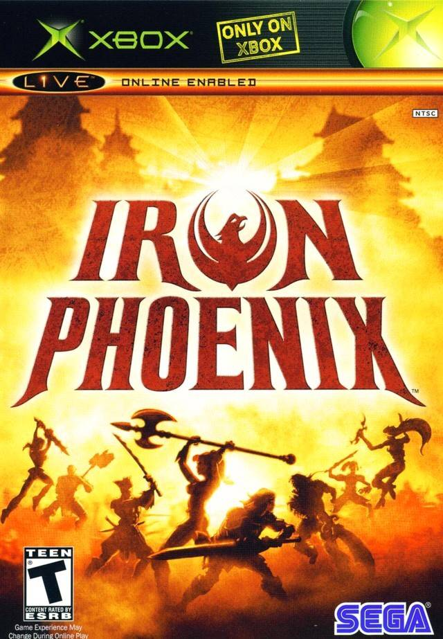

# Iron Phoenix — native PC port



A native Windows runtime for **Iron Phoenix** (Original Xbox, 2005). The game's own 32-bit x86 code runs
directly on the PC CPU without CPU emulation. The Xbox kernel is reimplemented and the Xbox GPU,
audio processor and network card are emulated (ported from [xemu](https://xemu.app)). On top of that it
adds modern display features:

- **High resolution**: internal render scale (default 3× → 1920×1440)
- **Widescreen**: real 16:9 3D projection, with the 2D UI and HUD laid out for 16:9 instead of stretched
- **High refresh rate**: configurable vblank rate (`--hz`)
- Full audio (LLE APU/DSP), intro movies, menus, offline matches with bots
- Texture replacement (drop-in PNG/JPG packs)

> **No game data is included.** This repository and its releases contain only the runtime.
> You need your own legally obtained copy of Iron Phoenix (an XISO dump of your disc).
> Iron Phoenix is © its respective owners; this project is not affiliated with them or with Microsoft.

## Quick start

1. Download `ironphoenix-nightly.zip` from the [nightly release](../../releases/tag/nightly)
   (rebuilt from the latest commit on `main`) and unzip it.
2. Extract your disc image into the `game` folder next to `ironphoenix.exe`, so that
   `game\default.xbe` exists (along with `Chara`, `Model`, `Scene`, `Script`, `*.xwb`, ...).
   Any XISO extractor works, or use the one in this repo:
   ```
   python tools/xiso.py IronPhoenix.iso game
   ```
3. Run `ironphoenix.exe`. Saves go to `save\` next to the exe; the log is written to `ironphoenix.log`.

**Requirements:** 64-bit Windows 10/11 (or Linux / Steam Deck through Proton, experimental) and a GPU with a
recent OpenGL 4.x driver.
Development and testing were done on NVIDIA GPUs (RTX 2070, GTX 1060).

The first launch compiles and caches GPU shaders (`shaders\`), so the boot logos take longer.

## Command-line options

| Option | Description |
|---|---|
| `--game DIR` | Game files directory (default: `game` next to the exe) |
| `--save DIR` | Save directory (default: `save` next to the exe) |
| `--scale N` | Internal resolution scale (default 3; 4 is GPU-heavy) |
| `--aspect 16:9\|4:3` | Output aspect ratio (default 16:9) |
| `--stretch-ui` | In widescreen, keep the original stretched 2D UI |
| `--fullscreen` | Start in fullscreen (toggle with Alt+Enter or F11) |
| `--hz N` | Emulated vblank rate (default 60; e.g. 120 for higher fps) |
| `--novsync` | Disable vsync pacing |
| `-vk`, `-vf` | Verbose kernel / file-access logging |

Developer options (`--trace`, `--profile`, `--input`, `--audio-dump`, `--shot-every`, `--dump-after`,
`XB_*` environment variables) are documented in [PROGRESS.md](PROGRESS.md).

Environment variables that can help on slower machines (Steam Deck):

| Variable | Effect |
|---|---|
| `XB_AUDIO_DSP=0` | Skip the audio DSP programs: much less CPU, no DSP effects such as reverb |
| `XB_OCCLUSION=late` | Don't stall the GPU thread on occlusion-query results |
| `XB_VP_WORKERS=N` | Audio voice worker threads (default: half the logical CPUs, at most 4) |

## Steam Deck / Linux (Proton)

Add `ironphoenix.exe` to Steam as a non-Steam game and force a Proton version in its Compatibility
settings. Environment variables go in the launch options, e.g. `XB_AUDIO_DSP=0 %command% --scale 2`.

## Controls

Xbox controllers map to XInput gamepads (Xbox 360/One/Series pads). Keyboard fallback:

| Xbox | Keyboard |
|---|---|
| Left stick | W A S D |
| Right stick | I J K L |
| D-pad | Arrow keys |
| A / B / X / Y | Space / E / Q / R |
| White / Black | Z / C |
| L / R trigger | Left Shift / Right Shift or F |
| Start / Back | Enter / Backspace |

## Texture replacement

Textures are identified by a hash of their data. To replace one:

1. Run with the environment variable `XB_TEX_DUMP=1` set (e.g. `set XB_TEX_DUMP=1` in a command prompt,
   then start `ironphoenix.exe`). Every texture the game loads is saved as `textures_dump\<hash>.png`
   next to the exe, the right way up and ready to edit.
2. Edit the image, or draw a new one, and save it as `textures\<hash>.png` (or `.jpg`) next to the exe.
3. Run normally (without `XB_TEX_DUMP`). The log reports `texture replacement: N file(s)`.

Replacements may have any size up to 8× the original and any aspect ratio. They are rescaled to fit
the original texture slot.

### 16:9 menu background

The UI runs in widescreen, but the menu background is 4:3 art, so by default it is stretched to fill
the screen. You can make your own 16:9 version (it also shows behind the scroll screens):

1. Dump textures as above and open the main menu. The background is `textures_dump\e798c2050382c4dc.png`
   (512×512; the game displays it stretched to 4:3).
2. Resize it to 4:3 (e.g. 2048×1536) to see its true proportions.
3. Widen the canvas to 16:9 (e.g. 2752×1536) and fill the new side areas by hand-painting, cloning or
   AI outpainting. Keep the original 4:3 area in the center unchanged.
4. Save the result as `textures\e798c2050382c4dc.jpg` (or `.png`). Use a 16:9 image; the runtime fits
   it into the texture slot and it is displayed at full width.

## Building

Builds use [llvm-mingw](https://github.com/mstorsjo/llvm-mingw) (i686 target) and a bash shell
(Git Bash works).

```bash
git clone --recursive https://github.com/godspirit00/IronPhoenix_port.git
cd IronPhoenix_port
# toolchain: unzip llvm-mingw-20261006-ucrt-x86_64.zip into ./toolchain
curl -LO https://github.com/mstorsjo/llvm-mingw/releases/download/20261006/llvm-mingw-20261006-ucrt-x86_64.zip
unzip -q llvm-mingw-20261006-ucrt-x86_64.zip -d toolchain
./build.sh          # incremental; ./build.sh clean for a full rebuild
```

Output: `build/ironphoenix.exe`. To use a toolchain elsewhere, set `TC=/path/to/llvm-mingw/bin`.
Run from the build folder with `./ironphoenix.exe`.

Every push to `main` is built by GitHub Actions ([.github/workflows/build.yml](.github/workflows/build.yml))
and published as the `nightly` release, which replaces the previous one.

## How it works

- The exe is linked at image base `0x10000` and reserves `0x11000–0x4B0000` in its own image. At startup
  the XBE sections are copied to their original addresses, so the game code runs unmodified at native speed.
- About 145 `xboxkrnl` exports are reimplemented (`src/kernel`). Xbox `fs:`-segment accesses are patched
  into calls (`src/cpu`). Timing (`rdtsc` @ 733 MHz) is rescaled to the host clock.
- **GPU**: the game's own D3D8 library drives a virtual NV2A. MMIO at `0xFD000000` is trapped (and
  hot-patched into direct calls). PFIFO/PGRAPH come from xemu's OpenGL renderer (`src/nv2a`).
- **Audio**: xemu's MCPX APU and DSP56300 interpreter (`src/apu`) feed WASAPI output.
- **Network**: xemu's nvnet with the link permanently down, so the game sees an unplugged console and
  offline play works.
- HLE hooks (`src/hle`) cover input, a few engine fixes and the widescreen UI script patches.

[PROGRESS.md](PROGRESS.md) is the detailed development log: findings, fixes and debugging tools.

### Repository layout

| Path | Contents |
|---|---|
| `src/` | Runtime sources (kernel, CPU patching, NV2A, APU, NIC, HLE, video/audio output) |
| `tools/` | Python helpers: XISO/XBE tools, disassembler, xref finder, code generators, profiler |
| `notes/` | Symbol/import tables extracted from the XBE (inputs to the generators) |
| `third_party/` | glad (vendored); libsamplerate, nv2a_vsh_cpu, xxHash, XbSymbolDatabase (submodules) |

## License

GPL-2.0-or-later (see [LICENSE](LICENSE)). It has to be: large parts of `src/nv2a`, `src/apu` and `src/net`
are derived from [xemu](https://github.com/xemu-project/xemu) / QEMU (GPL-2.0+ / LGPL-2.1+). Individual
files keep their original license headers.

## Credits

- [xemu](https://github.com/xemu-project/xemu): NV2A, MCPX APU/DSP and nvnet emulation
- [Cxbx-Reloaded](https://github.com/Cxbx-Reloaded/Cxbx-Reloaded) and
  [XbSymbolDatabase](https://github.com/Cxbx-Reloaded/XbSymbolDatabase): kernel reference and XDK symbol detection
- [nv2a_vsh_cpu](https://github.com/xemu-project/nv2a_vsh_cpu), [libsamplerate](https://github.com/libsndfile/libsamplerate),
  [xxHash](https://github.com/Cyan4973/xxHash), [glad](https://github.com/Dav1dde/glad)
- [llvm-mingw](https://github.com/mstorsjo/llvm-mingw) toolchain

Box art © SEGA, shown for identification only (scan via [LaunchBox Games Database](https://gamesdb.launchbox-app.com/games/details/41447-iron-phoenix)).
