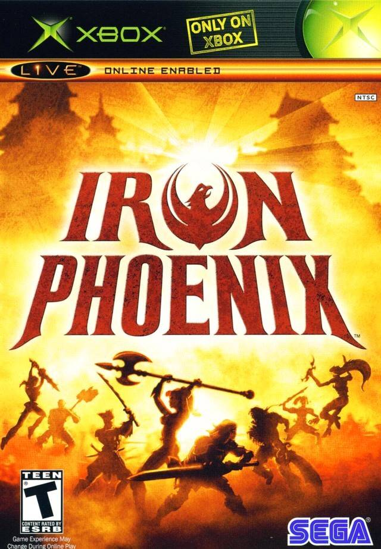

# Iron Phoenix — native PC port



A native Windows runtime for **Iron Phoenix** (Original Xbox, 2005). The game's own 32-bit x86 code runs
directly on the PC CPU without CPU emulation. The Xbox kernel is reimplemented and the Xbox GPU,
audio processor and network card are emulated (ported from [xemu](https://xemu.app)). On top of that it
adds modern display features:

- **High resolution**: internal render scale (default 3× → 1920×1440)
- **Widescreen**: real 16:9 3D projection, with the 2D UI and HUD laid out for 16:9 instead of stretched
- **High refresh rate**: configurable vblank rate (`--hz`)
- Full audio (LLE APU/DSP), intro movies, menus, offline matches with bots
- Texture replacement (drop-in PNG/JPG packs)

> **No game data is included.** This repository and its releases contain only the runtime.
> You need your own legally obtained copy of Iron Phoenix (an XISO dump of your disc).
> Iron Phoenix is © its respective owners; this project is not affiliated with them or with Microsoft.

## Quick start

1. Download `ironphoenix-nightly.zip` from the [nightly release](../../releases/tag/nightly)
   (rebuilt from the latest commit on `main`) and unzip it.
2. Extract your disc image into the `game` folder next to `ironphoenix.exe`, so that
   `game\default.xbe` exists (along with `Chara`, `Model`, `Scene`, `Script`, `*.xwb`, ...).
   Any XISO extractor works, or use the one in this repo:
   ```
   python tools/xiso.py IronPhoenix.iso game
   ```
3. Run `ironphoenix.exe`. Saves go to `save\` next to the exe; the log is written to `ironphoenix.log`.

**Requirements:** 64-bit Windows 10/11 (or Linux / Steam Deck through Proton, experimental) and a GPU with a
recent OpenGL 4.x driver.
Development and testing were done on NVIDIA GPUs (RTX 2070, GTX 1060).

The first launch compiles and caches GPU shaders (`shaders\`), so the boot logos take longer.

## Command-line options

The source checkout also contains an opt-in high-level `DrawVerticesUP` bridge:
launch `run-hle-up.cmd` to try it on OpenGL. This is an experimental hybrid
frontend, with state and resource handling still using the existing path.
See [prototype coverage and validation](docs/HLE_D3D8_PROGRESS.md).

`run-hle.cmd` additionally enables the indexed-draw bridge, covering the direct
indexed API used heavily in Buddha Cave. Both bridges are experimental and still
share the existing state/resource frontend. See
[indexed coverage and measurements](docs/HLE_INDEXED_PROGRESS.md).

`run-hle-resources.cmd` additionally tests resource identity tracking and native
vertex-input state preparation. It has not demonstrated a speedup; the existing
HLE launchers keep this mode off. See [resource-state progress](docs/HLE_RESOURCE_PROGRESS.md).

`run-hle-buffers.cmd` adds experimental OpenGL-owned vertex-range buffers and
per-draw content checks. It has passed a full Buddha Cave GPU-readback run but
does not establish a speedup or firm 60 fps. Existing HLE launchers keep buffers
off. See [buffer ownership progress](docs/HLE_BUFFER_PROGRESS.md).

The latest buffer build fixes severe cache thrashing reported on Yama Hall and
Summoning Altar. All 14 available arena scenes have now been exercised, including
an 11-map continuous session. Firm 60 remains unfinished; see the exact coverage,
remaining dips, and reusable regression tools in
[multi-map progress](docs/MULTIMAP_PROGRESS.md).

OpenGL now caches texture-stage bindings and anisotropy in ordinary play and
the HLE launchers. All-map driver-state checks pass; the ordinary Castle test
held 59--60 fps with fewer driver calls. Set `XB_NO_FAST_TEXTURE_STATE=1` to
restore the previous binding/anisotropy calls for comparison. Broad firm-60
performance remains unfinished. See [texture-state progress](docs/TEXTURE_STATE_PROGRESS.md).

Experimental Vulkan builds support `--renderer vulkan` (OpenGL remains available
with `--renderer opengl`). In this source checkout, `run-vulkan.cmd` launches the
Vulkan build with the extracted game at 3x scale and 60 Hz. See
[Vulkan integration status](docs/VULKAN_PROGRESS.md) for build instructions,
measurements, device requirements and remaining feature gaps.

| Option | Description |
|---|---|
| `--game DIR` | Game files directory (default: `game` next to the exe) |
| `--save DIR` | Save directory (default: `save` next to the exe) |
| `--scale N` | Internal resolution scale (default 3; 4 is GPU-heavy) |
| `--aspect 16:9\|4:3` | Output aspect ratio (default 16:9) |
| `--stretch-ui` | In widescreen, keep the original stretched 2D UI |
| `--fullscreen` | Start in fullscreen (toggle with Alt+Enter or F11) |
| `--hz N` | Emulated vblank rate (default 60; e.g. 120 for higher fps) |
| `--novsync` | Disable vsync pacing |
| `-vk`, `-vf` | Verbose kernel / file-access logging |

Developer options (`--trace`, `--profile`, `--input`, `--audio-dump`, `--shot-every`, `--dump-after`,
`XB_*` environment variables) are documented in [PROGRESS.md](PROGRESS.md).

Performance testing and current optimization status are recorded in
[docs/PERFORMANCE_STATUS.md](docs/PERFORMANCE_STATUS.md), including repeatable
benchmark commands and switches for comparing the original rendering paths.

Environment variables that can help on slower machines (Steam Deck):

| Variable | Effect |
|---|---|
| `XB_AUDIO_DSP=0` | Skip the audio DSP programs: much less CPU, no DSP effects such as reverb |
| `XB_OCCLUSION=exact` | Wait for each occlusion-query result before continuing (old default; `late` is now the default and doesn't stall the renderer) |
| `XB_VP_WORKERS=N` | Audio voice worker threads (default: half the logical CPUs, at most 4) |
| `XB_NO_CONSERVATIVE_DEPTH=1` | Disable conservative depth (OpenGL: lets the GPU reject hidden pixels early while keeping exact emulated depth; about a third less GPU time in effect-heavy scenes). For comparison or if you see missing geometry |
| `XB_VIS_WAIT=0` | Restore the game's original busy-wait for occlusion results (the default sleeps until the result arrives, freeing a CPU core) |
| `XB_SHADER_ASYNC=0` | Compile new shaders on the render thread again. By default a shader the cache doesn't have yet is compiled in the background and the draws that need it are skipped until it is ready (no stall, but an effect can be missing for a fraction of a second the first time it appears) |
| `XB_SHADER_THREADS=N` | Driver compiler threads for background shader compiles (default 2; 0 compiles them one at a time) |
| `XB_VK_QUERY_OUTSIDE_RP=1` | Vulkan: restore upstream occlusion-query handling (each query ends the render pass; slower) |
| `XB_NO_SHADER_CACHE=1` | Don't load or write the shader disk cache (testing) |
| `XB_LOG_SYNC=1` | Write log lines on the calling thread, as before (the default hands them to a writer thread, so a slow disk can't stall video or rendering) |

GTX 1060 / 4-thread CPU results and diagnostics (`XB_GPU_PROFILE=1`, `XB_CONSERVATIVE_VERIFY=1`,
`XB_PROFILE_APU_ONLY=1`, `XB_PROFILE_VP_ONLY=1`): see [docs/GTX1060_PROGRESS.md](docs/GTX1060_PROGRESS.md).

Audio A/B test switches (for reporting sound problems):

| Variable | Effect |
|---|---|
| `XB_AUDIO_DSP=0` | Same as xemu's default ("Real-time DSP processing" off) |
| `XB_AUDIO_HRTF=0` | No HRTF (3D positional) filtering |
| `XB_AUDIO_VOICE_LPF=0` | No per-voice low-pass filter |
| `XB_AUDIO_HRTF_FIX=0` | Undo the port's fix for mono 3D sounds (xemu's original mixing) |
| `XB_AUDIO_REVERB=x` | Scale the room-reverb send of 3D sounds (e.g. `0.5`; `0` = dry, DSP on only) |
| `XB_AUDIO_FC_ENV=0` | Ignore filter-envelope sweeps of the voice cutoff (xemu's behaviour) |
| `XB_VOICE_LOG=1` | Log every sound: 2D/3D, format, sample rate, filter cutoff, HRTF, mix bins |

## Steam Deck / Linux (Proton)

Add `ironphoenix.exe` to Steam as a non-Steam game and force a Proton version in its Compatibility
settings. Environment variables go in the launch options, e.g. `XB_AUDIO_DSP=0 %command% --scale 2`.

## Controls

Xbox controllers map to XInput gamepads (Xbox 360/One/Series pads). Mouse and keyboard also provide player 1:

| Xbox | Keyboard |
|---|---|
| Left stick | W A S D |
| Right stick / camera | Mouse movement or I J K L |
| D-pad | Arrow keys |
| A / Confirm | Space; Enter in menus |
| B / Evade / Back | Left Shift or E; Esc in menus |
| X / Attack 1 | Left mouse button or Q |
| Y / Attack 2 | Right mouse button or R |
| White / Black | Z / C |
| L trigger / Defend | Left Ctrl |
| R trigger | Middle mouse button, Right Shift or F |
| Start / Pause | Enter or Esc during gameplay; P anywhere |
| Back | Backspace |

Mouse movement is captured only during gameplay. Menus, pause screens and switching
to another window release the pointer. Mouse buttons send Xbox actions rather than
clicking menu items; use arrows and Enter/Esc to navigate menus. Held Enter/Esc
must be released before they can trigger an action after a menu transition.

Add `--mouse-sensitivity 0.5` to the executable's command line for slower camera
movement (default `1`, range `0.05` to `10`), or `--no-mouse-capture` to keep the
pointer free and use a controller/IJKL. The game's camera inversion setting still
applies. Mouse look emulates the right stick, including its maximum turning speed.
F11 or Alt+Enter toggles fullscreen.

## Texture replacement

Textures are identified by a hash of their data. To replace one:

1. Run with the environment variable `XB_TEX_DUMP=1` set (e.g. `set XB_TEX_DUMP=1` in a command prompt,
   then start `ironphoenix.exe`). Every texture the game loads is saved as `textures_dump\<hash>.png`
   next to the exe, the right way up and ready to edit.
2. Edit the image, or draw a new one, and save it as `textures\<hash>.png` (or `.jpg`) next to the exe.
3. Run normally (without `XB_TEX_DUMP`). The log reports `texture replacement: N file(s)`.

Replacements may have any size up to 8× the original and any aspect ratio. They are rescaled to fit
the original texture slot.

### 16:9 menu background

The UI runs in widescreen, but the menu background is 4:3 art, so by default it is stretched to fill
the screen. You can make your own 16:9 version (it also shows behind the scroll screens):

1. Dump textures as above and open the main menu. The background is `textures_dump\e798c2050382c4dc.png`
   (512×512; the game displays it stretched to 4:3).
2. Resize it to 4:3 (e.g. 2048×1536) to see its true proportions.
3. Widen the canvas to 16:9 (e.g. 2752×1536) and fill the new side areas by hand-painting, cloning or
   AI outpainting. Keep the original 4:3 area in the center unchanged.
4. Save the result as `textures\e798c2050382c4dc.jpg` (or `.png`). Use a 16:9 image; the runtime fits
   it into the texture slot and it is displayed at full width.

## Building

Builds use [llvm-mingw](https://github.com/mstorsjo/llvm-mingw) (i686 target) and a bash shell
(Git Bash works).

```bash
git clone --recursive https://github.com/godspirit00/IronPhoenix_port.git
cd IronPhoenix_port
# toolchain: unzip llvm-mingw-20261006-ucrt-x86_64.zip into ./toolchain
curl -LO https://github.com/mstorsjo/llvm-mingw/releases/download/20261006/llvm-mingw-20261006-ucrt-x86_64.zip
unzip -q llvm-mingw-20261006-ucrt-x86_64.zip -d toolchain
./build.sh          # incremental; ./build.sh clean for a full rebuild
```

Output: `build/ironphoenix.exe`. To use a toolchain elsewhere, set `TC=/path/to/llvm-mingw/bin`.
Run from the build folder with `./ironphoenix.exe`.

Every push to `main` is built by GitHub Actions ([.github/workflows/build.yml](.github/workflows/build.yml))
and published as the `nightly` release, which replaces the previous one.

## How it works

- The exe is linked at image base `0x10000` and reserves `0x11000–0x4B0000` in its own image. At startup
  the XBE sections are copied to their original addresses, so the game code runs unmodified at native speed.
- About 145 `xboxkrnl` exports are reimplemented (`src/kernel`). Xbox `fs:`-segment accesses are patched
  into calls (`src/cpu`). Timing (`rdtsc` @ 733 MHz) is rescaled to the host clock.
- **GPU**: the game's own D3D8 library drives a virtual NV2A. MMIO at `0xFD000000` is trapped (and
  hot-patched into direct calls). PFIFO/PGRAPH come from xemu's OpenGL renderer (`src/nv2a`).
- **Audio**: xemu's MCPX APU and DSP56300 interpreter (`src/apu`) feed WASAPI output.
- **Network**: xemu's nvnet with the link permanently down, so the game sees an unplugged console and
  offline play works.
- HLE hooks (`src/hle`) cover input, a few engine fixes and the widescreen UI script patches.

[PROGRESS.md](PROGRESS.md) is the detailed development log: findings, fixes and debugging tools.

### Repository layout

| Path | Contents |
|---|---|
| `src/` | Runtime sources (kernel, CPU patching, NV2A, APU, NIC, HLE, video/audio output) |
| `tools/` | Python helpers: XISO/XBE tools, disassembler, xref finder, code generators, profiler |
| `notes/` | Symbol/import tables extracted from the XBE (inputs to the generators) |
| `third_party/` | glad (vendored); libsamplerate, nv2a_vsh_cpu, xxHash, XbSymbolDatabase (submodules) |

## License

GPL-2.0-or-later (see [LICENSE](LICENSE)). It has to be: large parts of `src/nv2a`, `src/apu` and `src/net`
are derived from [xemu](https://github.com/xemu-project/xemu) / QEMU (GPL-2.0+ / LGPL-2.1+). Individual
files keep their original license headers.

## Credits

- [xemu](https://github.com/xemu-project/xemu): NV2A, MCPX APU/DSP and nvnet emulation
- [Cxbx-Reloaded](https://github.com/Cxbx-Reloaded/Cxbx-Reloaded) and
  [XbSymbolDatabase](https://github.com/Cxbx-Reloaded/XbSymbolDatabase): kernel reference and XDK symbol detection
- [nv2a_vsh_cpu](https://github.com/xemu-project/nv2a_vsh_cpu), [libsamplerate](https://github.com/libsndfile/libsamplerate),
  [xxHash](https://github.com/Cyan4973/xxHash), [glad](https://github.com/Dav1dde/glad)
- [llvm-mingw](https://github.com/mstorsjo/llvm-mingw) toolchain

Box art © SEGA, shown for identification only (scan via [LaunchBox Games Database](https://gamesdb.launchbox-app.com/games/details/41447-iron-phoenix)).
